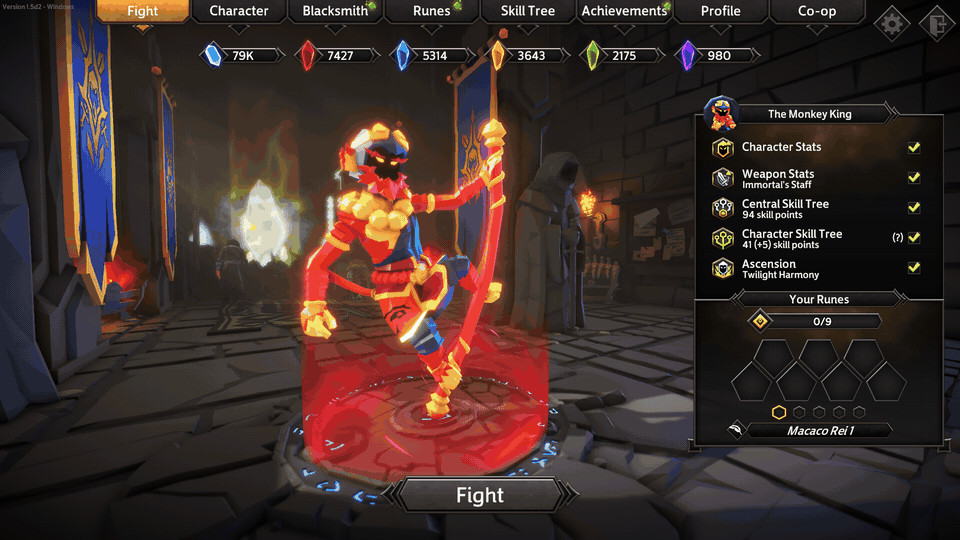

# Soulstone Coop

Online co-op for [Soulstone Survivors](https://store.steampowered.com/app/2066020/Soulstone_Survivors/): up to 8 players in the same run, invited through Steam.

An unofficial fan mod, not affiliated with or endorsed by the game's developers. Built on [BepInEx 6](https://github.com/BepInEx/BepInEx) (IL2CPP).

<p align="center"></p>
<p align="center"><sub><a href="docs/media/coop-ui-demo.mp4">Video (mp4)</a></sub></p>

> **Status: 1.7.** Played by two people over Steam; 3+ players have only been tested on one PC so far. See [What works](#what-works) and [Known limitations](#known-limitations).

## Install

> **Only download the mod from this repository's [Releases](../../releases).** Copies, re-uploads and ports hosted anywhere else are not made or checked by the author and could contain anything. Each release lists the zip's SHA-256: check it with `Get-FileHash .\SoulstoneCoop-<version>.zip` in PowerShell. See [SECURITY.md](SECURITY.md).

1. Download the latest `SoulstoneCoop-<version>.zip` from [Releases](../../releases).
2. Close the game. In Steam: right-click **Soulstone Survivors → Manage → Browse local files**.
3. Extract the zip into that folder. `winhttp.dll` and the `BepInEx` folder must end up **next to** `Soulstone Survivors.exe`, not inside a subfolder.
4. Launch the game from Steam. A black BepInEx console opens too; don't close it. **The first launch takes a few minutes** while BepInEx sets up; later launches are fast.
5. A **Co-op** tab in the main menu means the mod is loaded.

Requirements: Windows, the game on version **1.5.3.2**, and **both players on the same mod version** (different versions refuse to connect).

To uninstall, delete `winhttp.dll`, `doorstop_config.ini`, `.doorstop_version`, the `dotnet` folder and the `BepInEx` folder from the game folder.

## How to play

1. Both players launch the game from Steam and stay in the main menu.
2. **Host:** Co-op tab → **Invite friend**, and pick the friend in the Steam overlay. Without the overlay, use the Steam friends list → right-click the friend → *Invite to game*.
3. **Guest:** accept the invite in Steam chat. The Co-op panel shows *Connected with <name> (Steam, x ms)*. If the invite doesn't arrive, the host clicks **Copy code** and the guest pastes it into the panel and clicks **Join**.
4. Each player picks their own character; the **host** picks the map and presses Fight, and the guest's run starts by itself on the same map.

In a run:

- **1-4** pick an upgrade on the compact level-up panel (gamepad: D-pad left/right to choose, up to pick); **Tab** (or D-pad down) hides or shows it.
- **F4** (host) lifts everyone else's pause right away.
- A guest who connects while the host is in a run is brought into it; one who surrendered presses **Fight** in the menu to go back in (see [Known limitations](#known-limitations)).

Direct IP is also available (**Host by IP** / type the host's IP → **Join**, UDP port 7777). Over the internet it needs a gaming VPN (Tailscale, ZeroTier, Radmin) or a forwarded port.

## What works

| Area | Status |
|---|---|
| Connection | Steam invite (P2P through Steam's relay, no port forwarding), invite code, direct IP; mod version check |
| Lobby | Co-op tab in the menu; the host starts the run and the guest follows on the same map, mode, difficulty and curses |
| Players | Up to 8 (1 host + 7 guests); the host relays each player to the others |
| Partners | Shown with their own character, skin and weapon, Steam name, health bar, ally ring and minimap marker; smooth movement, dash and animations; their pets and summons (e.g. the Sentinel's panther), rotating shields, ascended / transformed look and their character's passive and mini-game objects (fallen legionnaires, demonic stones, shrines, the ghost ship, the ritual pyre, minerals...) are visible with their progress bars and fades, but only their owner can use those objects |
| Enemies | The host owns the world; the guest sees the same enemies, bosses, void hunters and specials, including boss area warnings; regular enemies animate their attacks on the guest too and turn to face the player they're fighting |
| Combat | Both players damage the same enemies; enemies chase and hit whoever is closest; statuses (slow, stun) reach the guest |
| Skills | Each player sees the other's skills (visual only; damage is synced separately), with channelled beams following their aim |
| Progression | Team XP (whoever picks up an orb, both get it), loot and kill credit on the guest; each player keeps their own level and upgrades |
| Chests and ore | Appear for everyone, and anyone can open them; each extra player standing on one opens it faster (`[Coop] ChestOpenBonusPerPlayer`); the loot goes to everyone; your own character says its line when you start opening one |
| Map tasks | The objective markers on the map appear for everyone, and any player can start them (faster with more players on the marker); everyone sees the task's timer or kill counter; the enemies and the reward are shared |
| Pause | Anyone's pause freezes everyone and the host can unpause for all; level-ups open as a compact see-through panel at the top of the screen that you keep playing under (1-4 or the gamepad's D-pad to pick) |
| Death | Downed state, any ally standing next to you revives you: a ring on the ground shows the revive area and fills as you're revived, and a line ties each downed player to the nearest living ally (stepping away to dodge only slowly drains the revive bar); XP you pick up while down is added when you get up (revived, victory or portal); defeat only when everyone is down; with the host down, enemies keep coming to the players still standing; the God's meteors go after every living player, not only the host; a party panel shows every partner's health, level, XP, revives left and whether they are down or dead |
| End of run | Victory, Home portal, Endless and challenge portals and Restart happen for everyone; the host surrendering ends the run for all |
| Disconnects | A dropped connection reconnects by itself for 45 s and the run goes on (no reload); the host leaving ends everyone's run with a notice; a guest leaving (or surrendering) lets the others continue |
| Language | The mod's own texts follow the game's language: English and Portuguese written by hand; Spanish, French, German, Russian, Chinese and Japanese machine-translated |

## Known limitations

- Rejoining a run in progress (`[Coop] AllowRejoin`, on by default since 1.6; older configs keep `false`): a dropped connection reconnects by itself for 45 s and keeps playing the same run with its build; a player who surrendered and rejoins with Fight, or anyone new, joins as a new character.
- If the host went through a portal, restarted or went back to the menu while you were disconnected, your old match ends a few seconds after you reconnect and you're brought into the host's current run as a new character.
- A guest's "on dash dodge" upgrades don't trigger (the dodge itself works since 1.6.1).
- Crusade mode is not supported in co-op.
- A partner's mod skin only shows if you have the same mod installed; otherwise you see their character's default skin.
- Another character's ascension effects need that character's assets in your game; when they aren't loaded, those effects are skipped. The Machinist's rotating crystals don't show on partners yet.

The full list and design notes are in [`docs/roadmap.md`](docs/roadmap.md).

## Roadmap

Next, in order (details in [`docs/roadmap.md`](docs/roadmap.md)):

1. Keeping your build when you come back with Fight, or after the host changed stage while you were away.
2. Guests' "on dash dodge" upgrades.
3. Crusade mode.

## Settings

`BepInEx/config/com.kolber.soulstonecoop.cfg` (created on first launch):

| Setting | Default | Meaning |
|---|---|---|
| `[Debug] LevelUpFullPanel` | `false` | Use the game's full-screen upgrade panel instead of the compact one (co-op upgrade choices never pause either way) |
| `[Coop] LevelUpPanelPosition` | `Top` | Where the compact upgrade panel sits: `Top` (above your character), or `Bottom`, `BottomLeft` or `BottomRight` (just above the health bar) |
| `[Coop] LevelUpOverlayScale` | `0.6` | Size of the compact upgrade panel (`1` = the game's size); it also shrinks to fit the screen |
| `[Coop] LevelUpOverlayOpacity` | `0.8` | Opacity of the compact upgrade panel while the mouse isn't over it |
| `[Coop] PartyHud` | `true` | In a run, a panel at the top left with each partner's health, level, XP, revives left and state (down, reviving, dead, disconnected) |
| `[Coop] EndRunWhenHostLeaves` | `true` | End the guest's run when the host disconnects |
| `[Coop] AllowRejoin` | `true` | Host: players can join a run in progress (connecting, or Fight in the menu); a dropped connection reconnects by itself for 45 s and keeps its build; `false` = they wait in the menu. Configs from before 1.6 keep `false` |
| `[Coop] MaxPlayers` | `8` | Lobby size (2-8) |
| `[Coop] EnemyScalePerPlayer` | `0` | Extra enemies per additional player (try `0.25`) |
| `[Coop] ReplicaCastRadius` | `60` | Don't draw skills of partners farther than this (also how far from a guest regular enemies' attack animations are sent) |
| `[Coop] ChestOpenBonusPerPlayer` | `0.5` | Host: extra opening speed for chests and ore per extra player standing on them (2 players x1.5, 3 x2, at most x3); `0` = same speed as alone |
| `[Coop] LobbyType` | `FriendsOnly` | `Public` if friends of guests can't join |
| `[Coop] Language` | `Auto` | Language of the mod's texts: `Auto` follows the game; or `en`, `pt-BR`, `es`, `fr`, `de`, `ru`, `zh`, `ja` |
| `[Coop] SenderClock` | `false` | Experimental: smoother remote movement on jittery connections |
| `[Updates] CheckForUpdates` | `true` | Check GitHub at startup and say in the main menu when a newer version is out (never downloads anything); `false` = no request at all |
| `[Updates] SkippedVersion` | `""` | Set by "Don't remind me for this version"; empty = remind about any newer release |
| `[Debug] SimulateLatencyMs`, `SimulateJitterMs`, `SimulatePacketLossPercent` | `0` | Simulate a bad network for testing |
| `[Debug] AutoHost` | `false` | Start hosting by IP as soon as the main menu opens |
| `[Debug] TestKeys` | `false` | Turn on the [test keys](#test-keys) |
| `[Debug] PowersProbe` | `false` | Log only: what your own hero spawns for its mini-game (to diagnose a hero whose objects don't show for partners) |

### Test keys

Used to test the mod; off unless `[Debug] TestKeys` is `true` (or the game is started with `--coop-test-keys`, which `tools/test-local` does). F4 and Tab (see [How to play](#how-to-play)) always work.

| Key | Window | What it does |
|---|---|---|
| F1 | guest | Drops the connection (tests the 45 s reconnect) |
| F2 | anyone, in a run | Gives your hero its mini-game mechanic for this run |
| F3 | host | Spawns a chest or ore next to you |
| F5 / Shift+F5 | host | Takes the Endless / Boss Rush portal |
| F6 / Shift+F6 | anyone, in a run | +1 / +5 levels for you (not shared) |
| F7 | host | Spawns a void presence, void hunters, a mineral and a pillar |
| F8 | host | Completes the kill objective, so the boss comes |
| F9 | anyone, in a run | Lethal hit on yourself |
| F10 | host | Victory |
| F11 | host | Revives everyone |
| Insert / Delete | anywhere, even outside co-op | Host by IP / connect to 127.0.0.1 |
| PageDown | anywhere, even outside co-op | Spawns a test copy of your character |

## Building from source

The plugin compiles against the interop assemblies BepInEx generates from the installed game, so a build needs the game installed with BepInEx 6 be.789 (IL2CPP) launched at least once. Those generated assemblies and anything else derived from the game are never committed.

```bash
dotnet build src/SoulstoneCoop
```

The build copies the plugin into the game's `BepInEx/plugins/SoulstoneCoop` (skip it with `-p:SkipDeploy=true`). If the game is installed elsewhere, pass `-p:GameDir=<path>`.

- `tools/test-local.cmd` (or `tools/test-local.ps1`) builds, installs and opens two game windows on this PC that connect by IP (A hosts, B joins), then collects their logs into `dist/test-local/`. It adds `steam_appid.txt` to the game folder for the session, which is what lets the game run twice outside Steam's launcher, and removes it at the end.
- `tools/package.ps1` builds the install zip into `dist/`.
- `tools/release.ps1` publishes a GitHub release: it checks the tree, makes a Release build, packages it, tags `v<version>` and uploads the zip. Bump `PluginVersion` in `src/SoulstoneCoop/Plugin.cs` and put the notes in `docs/releases/<version>.md` first. `-DryRun` runs everything except the tag and the upload.

Design notes for each phase (in Portuguese) are in [`docs/`](docs/), starting with [`docs/roadmap.md`](docs/roadmap.md).

## Credits

- [BepInEx](https://github.com/BepInEx/BepInEx) and [Il2CppInterop](https://github.com/BepInEx/Il2CppInterop): mod loader and IL2CPP interop, bundled in the release zip.
- [HarmonyX](https://github.com/BepInEx/HarmonyX): runtime patching.
- [LiteNetLib](https://github.com/RevenantX/LiteNetLib): direct-IP transport.

## License

Soulstone Coop is released under the [MIT License](LICENSE): you can use, modify, port and redistribute it, as long as the copyright notice stays with it. A credit and a link back to this repository are appreciated.

The release zip bundles third-party software under its own licenses (BepInEx and Il2CppInterop are LGPL); see [THIRD-PARTY-NOTICES.md](THIRD-PARTY-NOTICES.md). Nothing from the game itself is included.
